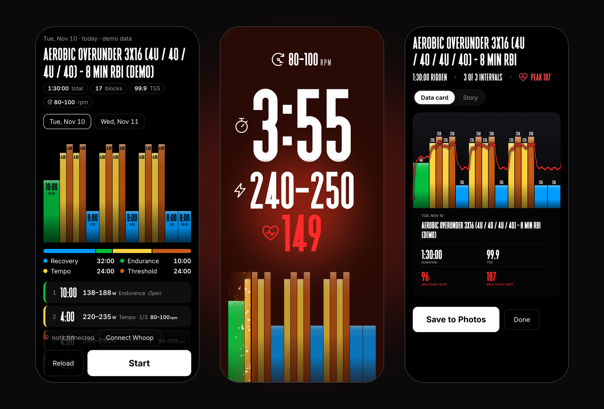
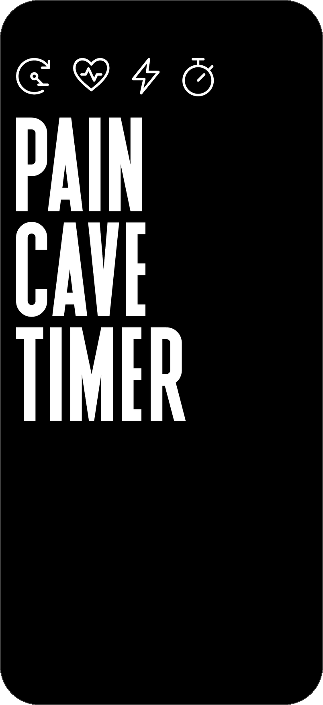
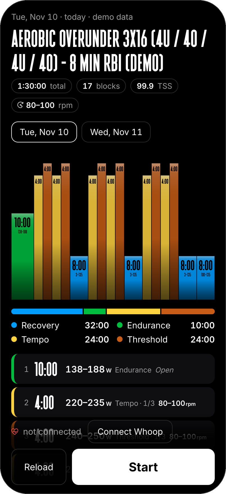
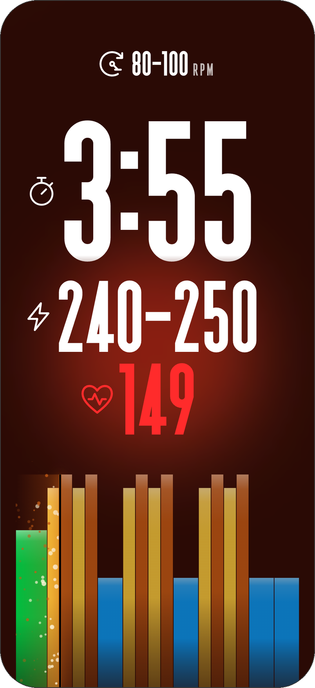
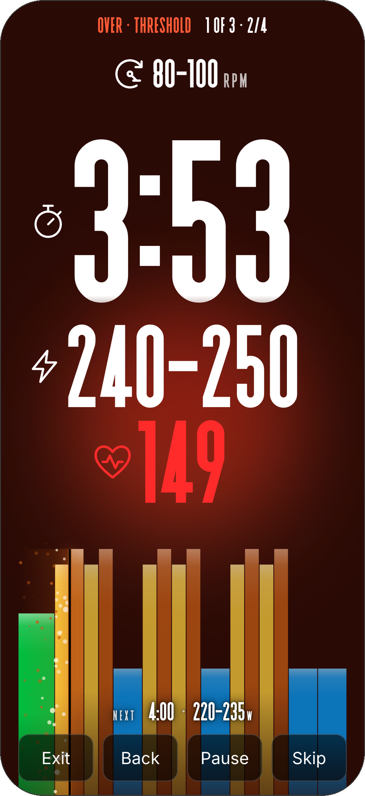
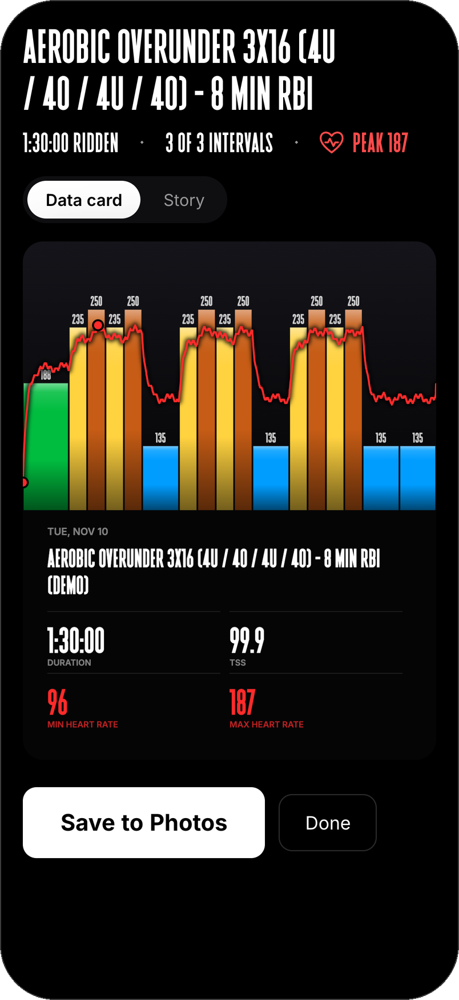
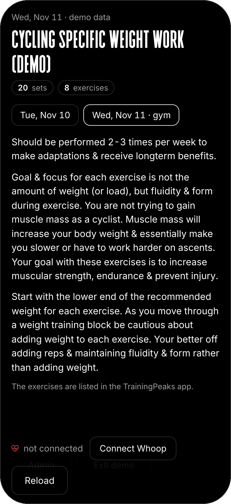

# Pain Cave Timer

A glanceable interval timer for coached indoor cycling.



If your coach plans your sessions in [TrainingPeaks](https://www.trainingpeaks.com),
you already get a "Schedule for …" email every evening with tomorrow's
workout. Pain Cave Timer reads that email, turns it into a list of blocks
(duration, target watts, zone, cadence), shows you the session to check, then
runs it full screen on your phone: one block at a time, big numbers,
an audio cue on every change, and live heart rate if you have a strap.

Built for a phone propped on the handlebars in portrait, read mid-effort.

**[Try the demo →](https://paincavetimer.vercel.app/?demo=1&fixture=review)**
ten sample sessions, no account or mailbox needed. Add `&bpm=150` to simulate
a heart-rate strap.

## Screens

<table>
  <tr>
    <td width="33%" align="center"></td>
    <td width="33%" align="center"></td>
    <td width="33%" align="center"></td>
  </tr>
  <tr>
    <td align="center"><b>Opening</b></td>
    <td align="center"><b>Check the session</b></td>
    <td align="center"><b>Ride</b></td>
  </tr>
  <tr>
    <td width="33%" align="center"></td>
    <td width="33%" align="center"></td>
    <td width="33%" align="center"></td>
  </tr>
  <tr>
    <td align="center"><b>Tap for controls</b></td>
    <td align="center"><b>Share the ride</b></td>
    <td align="center"><b>Gym days</b></td>
  </tr>
</table>

Screenshots are from demo mode on an iPhone 17 Pro-sized screen (402×874).

## Features

- **No copying workouts by hand.** Fetches the coach's email over IMAP and
  parses TrainingPeaks' markup: warm-ups, repeats, ramps, over-unders,
  "Repeat N times" sets, cadence, heart-rate notes.
- **Check before you ride.** A confirmation screen with the session's shape
  (each bar labelled with its time and watts), time in each power zone, and one
  row per block. Anything the parser wasn't sure of is listed, never dropped.
- **Ride screen.** Countdown, target watts, zone, set position ("2 of 3"), the
  coach's cadence / RPE / heart-rate cues, and a profile chart with a "now"
  line. Blocks auto-advance with distinct start, work, recovery and 3-2-1 cues.
- **Only the numbers until you tap.** Time, watts, heart rate and cadence stay
  on screen; the first tap brings up the controls, the zone and set position,
  and what's next, and they all sink away after 3 s. No accidental pauses.
- **Heart rate over Bluetooth** (tested with a Whoop broadcasting heart rate):
  live BPM, a heart-rate line over the chart, and an animated background that
  pulses with your heart.
- **End-of-ride image.** A 4:5 data card or 9:16 story with the session
  profile, planned peak watts per block and min/max heart rate, saved to Photos
  through the share sheet.
- **Gym days.** The coach's gym sessions ("Cycling Specific Weight Work") show
  as text: sets, exercises and the coach's notes. The exercise list itself
  isn't in the email, only in the TrainingPeaks app.
- **Yesterday too.** The start screen has a tab for yesterday's session next
  to today and tomorrow, and Admin and Demo buttons at the bottom.
- **Your zones, your colours.** Edit power zones, colours, resting/max heart
  rate and the "now" line style at `/admin`.

## Try it without a mailbox

```bash
npm install
npm run dev
```

Open <http://localhost:3000/?demo=1&fixture=review>. Demo mode uses the
redacted sample emails in `fixtures/` and needs no configuration.

| Parameter | What it does |
|---|---|
| `demo=1` | Use sample workouts instead of the mailbox; no token needed |
| `fixture=review` | Ten real sessions as ten day tabs: steady state, sweet spot, 3.5 h endurance, recovery, power ladders, step ramps, two over-under shapes |
| `fixture=sweetspot` · `overunder` · `steadystate` · `gym` | A single sample email (two days); `gym` is a ride plus a gym session |
| `bpm=150` | Simulate a heart-rate strap |
| `at=end` | Start 8 s before the finish with a simulated heart-rate trace, to see the end screen |
| `fx=ember` · `comet` · `plasma` · `stardust` | Preview a "now" line style |
| `wait=5` | Hold the loading screen for 5 s, to see it after the opening splash |

## Run your own

You need a TrainingPeaks account whose coach-scheduled workouts are emailed to
an inbox you can reach over IMAP, and somewhere to host a Next.js app. It's
built for [Vercel](https://vercel.com).

1. **Fork and deploy** the repo to Vercel.
2. **Mailbox access.** For Gmail, turn on 2-step verification and create an
   [App Password](https://support.google.com/accounts/answer/185833).
3. **Environment variables** (Vercel → Project → Settings → Environment
   Variables; for local runs, copy `.env.example` to `.env.local`):

   | Name | Purpose |
   |---|---|
   | `MAIL_HOST`, `MAIL_PORT`, `MAIL_USER`, `MAIL_PASSWORD` | IMAP login (`imap.gmail.com`, `993`, your address, the App Password) |
   | `MAIL_FROM` | Sender to trust: `messages-no-reply@trainingpeaks.com` |
   | `APP_TIMEZONE` | Your IANA time zone, so "today" is right (Vercel runs in UTC) |
   | `APP_TOKEN` | A long random string; the app asks for it once and stores it on the device |
   | `BLOB_READ_WRITE_TOKEN` | A private [Vercel Blob](https://vercel.com/docs/vercel-blob) store for `/admin` settings and the saved emails (added for you when you connect a store) |
   | `CRON_SECRET` | A long random string; Vercel Cron sends it to `/api/cron/refresh`. Without it the cron is refused; loads still work, reading the mailbox whenever the saved copy doesn't cover the day |
   | `FTP_WATTS` | Optional. Only needed if your coach writes targets as % of FTP |
   | `THR_BPM` | Optional. Turns "84-92% of THR" notes into a BPM range |

4. **Open it on your phone**, enter the token, and add it to the home screen.
   For heart rate on iPhone use the Bluefy
   browser (Safari has no Web Bluetooth); Chrome and Edge work on Android,
   macOS and Windows.
5. **Set your zones** at `/admin` (the token is needed to save). "Calculate
   from FTP" fills zone tops at 55, 75, 90, 105 and 120% of FTP, the
   TrainingPeaks formula.

Check locally that the mailbox works:

```bash
npm run fetch
npm run fetch -- --date 2026-10-24 --json
```

## How it works

```
TrainingPeaks email ─IMAP─▶ /api/workout ─▶ parser ─▶ Workout { blocks[] } ─▶ Confirm ─▶ Ride ─▶ Summary
```

1. **Fetch.** A cron job (`/api/cron/refresh`, scheduled in `vercel.json` at
   13:40, 21:40 and 23:40 UTC, after the nightly email) opens a short-lived
   IMAP connection, reads the five newest messages from `MAIL_FROM`, and saves
   them to the private Blob store (`mail-cache/<environment>.json`, with the
   time it read them). `GET /api/workout?date=yyyy-mm-dd` (bearer `APP_TOKEN`)
   answers from that copy when it covers the date and is under 36 hours old;
   otherwise, or with `fresh=1` (the Reload button), it reads the mailbox
   itself and saves the result. The response says which (`source: "cache"` or
   `"live"`), with `fetchedAt` and `durationMs`. The emails are kept raw and
   parsed on each request, so parser or FTP changes apply at once. Each email
   covers two days, so yesterday's session is taken from the email before,
   for its own tab. There is no nearest-day fallback: a missing date is a 404
   listing the days seen.
2. **Extract.** `email-html.ts` anchors on TrainingPeaks' markup: one
   `h1.formattedDate` per day, the title, Time and TSS, the description, and
   an `<ol>` of steps.
3. **Parse steps.** `step.ts` reads
   `20 min @ 138-188 W - Recovery-Endurance - 80-95 rpm` into duration, watt
   range, zone and cadence; `target.ts` also handles % of FTP, zone-only
   targets and heart-rate notes.
4. **Nested lists.** A step can hold a nested list. Titled "Repeat 4 times",
   its steps are ridden four times over ("1 of 4" … "4 of 4"). Any other title
   ("Ramp up in 4 steps") is one interval ridden once, one block per step;
   two alternating targets are labelled Under and Over.
5. **Expand and build.** `expand.ts` unrolls everything into flat blocks with
   a kind (warm-up, work, recovery, cool-down), start time, audio cue and set
   position. TrainingPeaks often sends repeats already flattened, so set
   numbers are also recovered from runs of identical work blocks.
6. **Cadence.** A step's own rpm wins. Work intervals without one take the
   session-wide "Cadence: 80-100 RPM" from the description. Everything else
   shows **Open**.

Nothing is dropped silently: every workout carries `warnings` (planned time
mismatch, missing watt targets) and `unparsed` lines, shown on the
confirmation screen. Typed or pasted workouts (a `3x` line followed by indented
steps, see `fixtures/coach-text-repeats.txt`) go through `text.ts`.

## Development

```bash
npm test             # vitest: parser, fixtures, timer, settings, summary
npm run lint         # ESLint with the React Compiler rules
npm run typecheck
npm run parse -- fixtures/trainingpeaks-overunder-3x16.html
npm run parse -- fixtures/coach-text-repeats.txt --ftp 250
```

**Adding a sample email.** Save the raw HTML body (or `.eml`) in
`fixtures/raw/`, which is gitignored: real TrainingPeaks emails carry account
and unsubscribe tokens in their links. Then

```bash
npm run redact -- fixtures/raw/my-email.html fixtures/trainingpeaks-my-email.html
```

strips links, image sources, tracking URLs, email addresses and styles while
keeping the workout markup intact. Read the result for names or personal notes
before committing, and add a test that parses it.

### Layout

```
src/lib/workout/      parser: types, zones, duration, target, step, text, email-html, expand, index, demo
src/lib/mail/         IMAP source (imapflow + mailparser), env config, saved-email cache
src/app/api/workout/  workout endpoint (token, or ?demo=1; cache first, fresh=1 for live)
src/app/api/cron/     refresh: saves the newest emails (CRON_SECRET)
src/app/api/settings/ zones and display settings (GET open, PUT needs the token)
src/app/admin/        settings page
src/components/       App (phases) · Confirm / ConfirmHero · Ride · Summary · WorkoutProfile · PlayheadFx · Admin
src/lib/              timer helpers, audio cues, heart rate, profile geometry, settings, summary image, playhead effects
src/components/animate-ui/  copied Animate UI primitives (lint-excluded)
scripts/              parse, fetch and redact CLIs
fixtures/             redacted sample emails used by tests and demo mode
docs/screenshots/     README images, captured from demo mode at 402×874
```

## Design notes

- **Profile chart** (`WorkoutProfile`, `src/lib/profile.ts`): one bar per
  block, width = duration, height = top of the watt target, colour = your
  power zone (from the middle of the block's watt range). The axis starts
  below the easiest block so small steps show. Ridden time is full strength,
  the current block pulses, and a black "now" line runs from its top to the
  bottom of the screen with particles trailing behind (four styles, canvas).
  Pulse and particles scale with heart rate between resting and max.
- **Background** (`RideBackground`): Animate UI's bubble background in plain
  CSS, coloured by block intensity, pulsing once per heartbeat (period =
  60 / BPM).
- **Motion**: rolling countdown digits, counting watts, blur transitions and a
  spring for the controls, from [Animate UI](https://animate-ui.com) primitives
  on [Motion](https://motion.dev). Respects reduced-motion settings.
- **End-of-ride image** (`src/lib/summary-card.ts`): drawn straight onto a
  canvas, so it renders the same in every browser. "Save to Photos" uses the
  Web Share API with a file, called synchronously inside the tap as iOS
  requires; where sharing files isn't supported, a full-screen image with a
  press-and-hold hint and a download link appears instead.
- **Type**: display sizes use II Balfron where licensed (see Fonts), with each
  digit in a fixed-width cell so the countdown doesn't shift; reading text
  uses Inter with tabular figures.

## Known gaps

- "Save to Photos" hasn't been confirmed inside Bluefy on iPhone.

## Privacy and secrets

No credentials live in the repo. Mailbox settings and tokens are environment
variables only; `.env.local` and `fixtures/raw/` are gitignored and excluded
from Vercel uploads. The workout endpoint and settings writes need
`APP_TOKEN`; demo mode serves only the redacted fixtures.

## Fonts

Display sizes are designed around II Balfron (Evan Lelliott / Increments Type
Foundry), a commercial face that is **not** in this repository and not covered
by its licence. The app asks for it at `/fonts/display`, which serves:

1. `private/fonts/ii-balfron.woff` if you have a licensed copy there (the
   `private/` folder is gitignored and never uploaded), or
2. `fonts/ii-balfron.woff` from the project's private Vercel Blob store, or
3. nothing, in which case the open [League Gothic](https://fonts.google.com/specimen/League+Gothic)
   is used instead.

Without Balfron the countdown digits are slightly wider than their fixed cells
were tuned for; to use another face, change the `@font-face` at the top of
`src/app/globals.css`.

## Licence

[MIT](LICENSE), for the code. The II Balfron font is excluded (see above).
